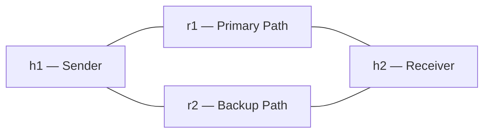

# Reliable UDP Transfer with SDN Failover

This project implements a reliable data transfer protocol over UDP using Stop-and-Wait ARQ and demonstrates dynamic SDN-style network failover using a custom C-based controller. Originally designed for Kathara, this lab has been ported to Mininet to allow for strict, namespace-isolated point-to-point link control.

## Features

- **Stop-and-Wait ARQ:** A custom C implementation of reliable UDP file transfer that handles packet loss, timeouts, and acknowledgements.
- **Mininet Emulation:** A custom Python script (`topology.py`) that builds an isolated diamond-shaped network topology with direct Ethernet links.
- **Dynamic Failover:** A C-based controller that monitors network health and dynamically rewrites Linux IP routing tables to switch to a backup path when the primary link drops.
- **Simulated Packet Loss:** The primary path enforces an artificial 5% packet drop rate to stress-test the retransmission logic.

## Network Topology

The network consists of two hosts (`h1`, `h2`) and two routers (`r1`, `r2`) arranged in a diamond topology:



- **h1 (Sender):** Initiates the file transfer.
- **h2 (Receiver):** Receives data and acknowledges via a custom loopback interface (`10.0.4.2`).
- **r1 (Router 1):** Primary routing path, subject to 5% packet loss.
- **r2 (Router 2):** Backup routing path.

## Prerequisites

To run this simulation, you need an Ubuntu/Debian Linux environment (WSL is supported) with:

- `mininet` — Network emulator.
- `xterm` — Host terminal windows.
- `gcc` — Compiler for the C programs.
- Mininet `m` utility installed in `/usr/local/bin/`.

## How to Run the Failover Demonstration

### 1. Start the Mininet Topology

Open a terminal and start the Mininet environment:

```bash
sudo python3 topology.py
```

Leave this terminal open. You will use the `mininet>` prompt to trigger the failover later.

### 2. Compile the Code

Open a second terminal in the project directory and compile the C source files:

```bash
gcc kathara_lab/controller.c -o controller
gcc kathara_lab/h1/sender.c -o sender
gcc kathara_lab/h2/receiver.c -o receiver
```

### 3. Start the Network Controller

In the second terminal, run the controller with root privileges so it can modify network namespaces:

```bash
sudo ./controller
```

### 4. Initiate the File Transfer

Return to the first terminal and run the following at the Mininet prompt:

```text
mininet> xterm h1 h2
```

In the **h2 (Receiver)** window, run:

```bash
./receiver
```

In the **h1 (Sender)** window, create a test file and run the sender:

```bash
dd if=/dev/urandom of=large.txt bs=1024 count=50
./sender
```

Select **option 2 — Network Transfer**, then enter `large.txt` as the filename.

### 5. Trigger the Failover

While the file is transferring, return to the Mininet prompt and bring down the primary link:

```text
mininet> link r1 h2 down
```

The sender (`h1`) will temporarily stall with timeouts. The controller will detect the broken path, terminate the stuck processes, and update the routing tables on `h1` and `h2` to route traffic through `r2`.

Restart the receiver on `h2`:

```bash
./receiver
```

Restart the sender on `h1`:

```bash
./sender
```

Select the network transfer option and enter the filename again. The transfer will run over the backup path.

> **Note:** Route switching is automatic, but this demonstration requires manually restarting the sender and receiver after failover.
